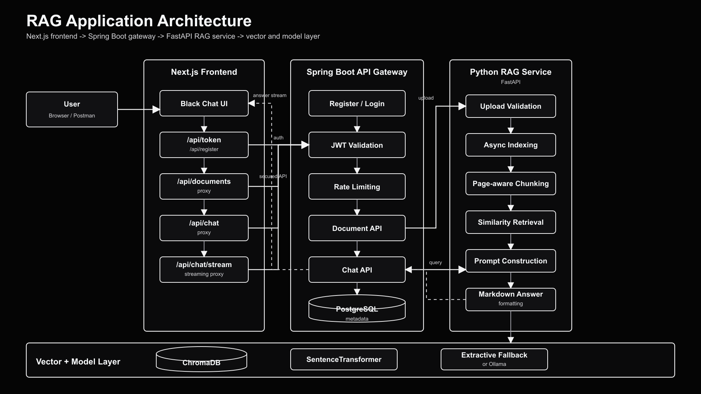

# 🚀 Full-Stack Enterprise RAG Pipeline

<div align="center">

[](https://python.org)
[](https://fastapi.tiangolo.com/)
[](https://spring.io/projects/spring-boot)
[](https://nextjs.org/)
[](https://www.postgresql.org/)
[](https://www.trychroma.com/)
[](https://docker.com)
[](LICENSE)

<p align="center">
  A production-ready, full-stack <b>Retrieval-Augmented Generation (RAG)</b> platform featuring multi-format document ingestion, ChromaDB vector search, a Python FastAPI RAG microservice, an enterprise Spring Boot API Gateway with JWT & Token Bucket rate limiting, and a sleek Next.js streaming chat interface.
</p>

</div>

---

## 📸 System Architecture

<div align="center">
  
</div>

> 📘 Detailed architectural diagrams, SVG source, and request flow sequences are available in [docs/architecture.md](docs/architecture.md).

---

## ✨ Key Features & Capabilities

- 📄 **Multi-Format Ingestion**: Supports text-based PDFs, Markdown (`.md`), and plain text (`.txt`) documents with page-aware chunking and character limits.
- ⚡ **Asynchronous Indexing & De-duplication**: Non-blocking background indexing with SHA-256 duplicate detection per user to prevent redundant vector storage.
- 🔍 **Hybrid Dense Retrieval**: Powered by `sentence-transformers/all-mpnet-base-v2` dense embeddings stored in persistent **ChromaDB**, with cross-encoder re-ranking via `cross-encoder/ms-marco-MiniLM-L-6-v2`.
- 🧠 **Dual LLM Generation & Citations**: Real-time token streaming with local **Ollama** models (e.g., Llama 3) or extractive grounding fallback, generating precise page-level citations.
- 🛡️ **Enterprise API Gateway (Spring Boot)**:
  - Stateless **JWT Bearer Authentication** with BCrypt password hashing.
  - **Token Bucket Rate Limiting** to prevent DoS attacks and resource exhaustion.
  - PostgreSQL-backed user and document metadata isolation (multi-tenancy ready).
- 💬 **Real-Time Streaming Chat (Next.js 15)**: Dark-themed modern web UI with Server-Sent Events (SSE) streaming, citation badges, document upload progress, and user authentication.
- 🐳 **One-Click Container Orchestration**: Full `docker-compose.yml` multi-container setup with health checks and automated PowerShell helper scripts.

---

## 🧱 Technology Stack

| Layer | Technology | Key Libraries / Frameworks |
| :--- | :--- | :--- |
| **Frontend UI** | Next.js 15, React 19, TypeScript | Tailwind CSS, Lucide Icons, SSE Client |
| **API Gateway** | Spring Boot 3.4, Java 21 | Spring Security, Spring Data JPA, Flyway, WebClient |
| **RAG Microservice**| Python 3.12, FastAPI | Uvicorn, Pydantic, PyTorch, Hugging Face Transformers |
| **Vector Store** | ChromaDB | SentenceTransformers, Cross-Encoder |
| **Relational DB** | PostgreSQL 16 | Flyway Schema Migrations, HikariCP |
| **LLM Inference** | Ollama / Extractive Fallback | Llama 3.2, Local Context Extraction |
| **DevOps & Tooling**| Docker & Docker Compose | Multi-stage Dockerfiles, Postman Collections, Pytest |

---

## 📁 Repository Structure

```text
RAG_Pipeline/
├── backend-spring/              # Spring Boot 3.4 API Gateway (Java 21)
│   ├── src/main/java/           # Auth, Chat, Document, RateLimiter, Security
│   ├── src/main/resources/      # application.yml, Flyway migrations (V1__init.sql)
│   ├── Dockerfile               # Multi-stage Maven + Temurin JRE build
│   └── pom.xml                  # Maven dependency configuration
├── frontend-next/               # Next.js 15 Chat Web Application (TypeScript)
│   ├── app/                     # Next.js App Router (UI & API route proxies)
│   ├── lib/                     # Client helper utilities & SSE handlers
│   ├── Dockerfile               # Multi-stage Node.js Alpine runner
│   └── package.json             # Frontend dependencies & scripts
├── rag_service/                 # FastAPI RAG Microservice (Python 3.12)
│   ├── config.py                # Environment configuration loader
│   ├── llm.py                   # LLM provider integration (Ollama / Extractive)
│   ├── main.py                  # FastAPI route declarations & lifespan events
│   ├── schemas.py               # Pydantic request / response schemas
│   ├── service.py               # Document ingestion, indexing, and QA orchestrator
│   └── vector_store.py          # ChromaDB persistence and cosine query engine
├── docs/                        # Architecture diagrams and technical documentation
│   ├── images/                  # 4K architecture diagrams and vector SVG assets
│   └── architecture.md          # Architectural deep-dive & sequence flows
├── sample_documents/            # Ready-to-upload documents for testing
│   ├── rag_overview.txt         # Comprehensive RAG overview for semantic queries
│   ├── test_notes.txt           # Short note on RAG concepts
│   └── README.md                # Guide to testing document uploads
├── tests/                       # Automated test suite
│   ├── test_advanced_rag_core.py# Core chunking and retrieval tests
│   └── test_rag_service_api.py  # FastAPI endpoint and mock ingestion tests
├── advanced_rag.py              # Advanced RAG engine core algorithms
├── benchmark_latency.py         # End-to-end query latency benchmark utility
├── docker-compose.yml           # Multi-service container orchestration
├── docker-start.ps1             # PowerShell container lifecycle manager
├── Dockerfile.rag               # Python FastAPI container definition
├── evaluate_rag.py              # Quantitative evaluation harness
├── export_chroma_to_csv.py      # ChromaDB to CSV export utility
├── golden_test_set.json         # Evaluation queries with expected ground truth
├── install_requirements.ps1     # Automated Python virtualenv setup script
├── postman_collection.json      # Complete Postman E2E testing collection
├── requirements.txt             # Python dependencies
├── .env.example                 # Local environment template
├── .env.docker                  # Docker compose environment defaults
└── LICENSE                      # MIT Open Source License
```

---

## 🐳 Quick Start with Docker (Recommended)

Run the entire multi-service stack (PostgreSQL, Python RAG service, Spring Gateway, Next.js UI) in a single command:

```powershell
# Option 1: Using the PowerShell management helper
.\docker-start.ps1 -Build

# Option 2: Using Docker Compose directly
docker compose --env-file .env.docker up -d --build
```

### Active Service Endpoints

| Service | Container Name | Endpoint URL | Status / Health |
| :--- | :--- | :--- | :--- |
| **Next.js Web UI** | `rag-frontend` | [http://localhost:3000](http://localhost:3000) | `curl http://localhost:3000` |
| **Spring Boot Gateway** | `rag-gateway` | [http://localhost:8080](http://localhost:8080) | [http://localhost:8080/actuator/health](http://localhost:8080/actuator/health) |
| **FastAPI RAG Service** | `rag-service` | [http://localhost:8000](http://localhost:8000) | [http://localhost:8000/health](http://localhost:8000/health) |
| **PostgreSQL Database** | `rag-postgres` | `localhost:5432` | DB: `rag_gateway`, User: `rag` |

To monitor real-time logs or stop containers:
```powershell
docker compose logs -f
docker compose down
```

---

## 💻 Local Development Setup

### 1. Prerequisites
- **Python**: 3.12+ (or 3.11)
- **Java**: JDK 21+ & Maven 3.9+
- **Node.js**: 20+ & npm
- **PostgreSQL**: 14+ running locally (default: `rag_gateway`, user: `rag`, pass: `rag`)

### 2. Database Initialization
```sql
CREATE USER rag WITH PASSWORD 'rag';
CREATE DATABASE rag_gateway OWNER rag;
```

### 3. Python FastAPI RAG Service
```powershell
# Create virtual environment and install dependencies
.\install_requirements.ps1
.\venv_py312\Scripts\Activate.ps1

# Start the FastAPI service
python -m uvicorn rag_service.main:app --host 127.0.0.1 --port 8000 --reload
```
*Health Check*: `http://127.0.0.1:8000/health`

### 4. Spring Boot API Gateway
```powershell
cd backend-spring
mvn clean spring-boot:run
```
*Health Check*: `http://127.0.0.1:8080/actuator/health`

### 5. Next.js Frontend
```powershell
cd frontend-next
npm install
npm run dev
```
*Web UI*: `http://localhost:3000`

---

## 🔌 API Gateway Specifications

All public requests flow through the Spring Boot API Gateway (`http://localhost:8080`).

### Authentication Endpoints
- `POST /api/auth/register` - Create new user account (`username`, `email`, `password`)
- `POST /api/auth/token` - Authenticate and obtain JWT Bearer Token (`username`, `password`)

### Document Management Endpoints (Secured with JWT)
- `POST /api/documents/upload` - Upload file (`multipart/form-data`) with optional `source` label
- `GET /api/documents` - List all uploaded documents for the authenticated user
- `GET /api/documents/{id}` - Retrieve details and indexing status of a document
- `DELETE /api/documents/{id}` - Delete document and purge vector chunks from ChromaDB

### Query & Chat Endpoints (Secured with JWT & Rate Limited)
- `POST /api/chat` - Synchronous grounded query response
- `POST /api/chat/stream` - Server-Sent Events (SSE) streaming response with citations

### E2E Testing with Postman
Import the included [`postman_collection.json`](postman_collection.json) into Postman to test the full lifecycle:
1. Health Checks
2. Register & Login
3. Upload Document (`sample_documents/rag_overview.txt`)
4. Poll Document Indexing Status
5. Grounded RAG Chat Query
6. Token Bucket Rate Limiting Test

---

## 🧪 Automated Testing & Verification

Run tests across each layer of the application:

```powershell
# 1. Python Unit and API Tests
python -m pytest tests -v

# 2. Spring Gateway Security & Controller Tests
cd backend-spring
mvn test

# 3. Next.js Typecheck & Production Build
cd frontend-next
npm run typecheck
npm run build
```

---

## 📄 License

Distributed under the **MIT License**. See [`LICENSE`](LICENSE) for more information.

---

## 👤 Author

**Rohan Tidke**
- GitHub: [@rohantidke](https://github.com/rohantidke)
- Repository: [RAG_Pipeline](https://github.com/rohantidke/RAG_Pipeline)
