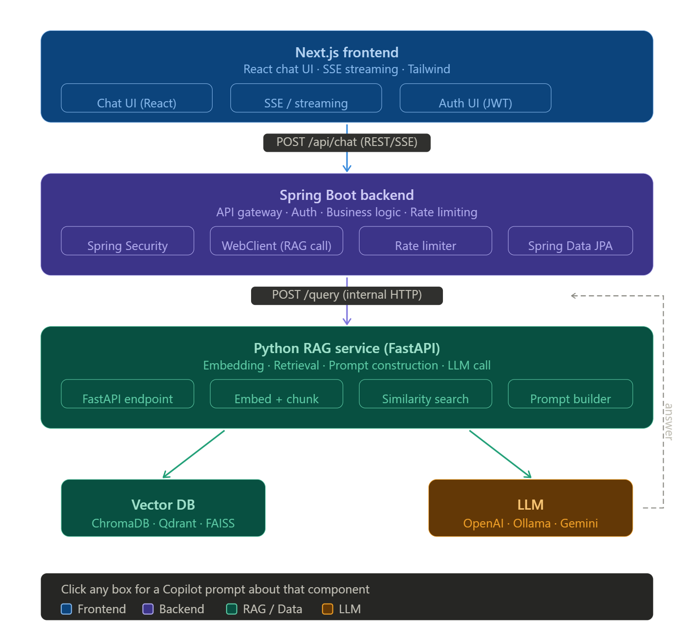
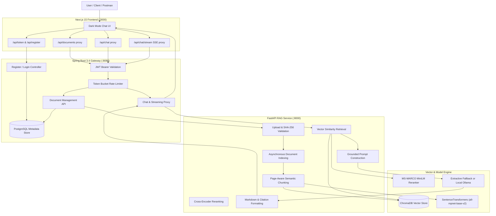
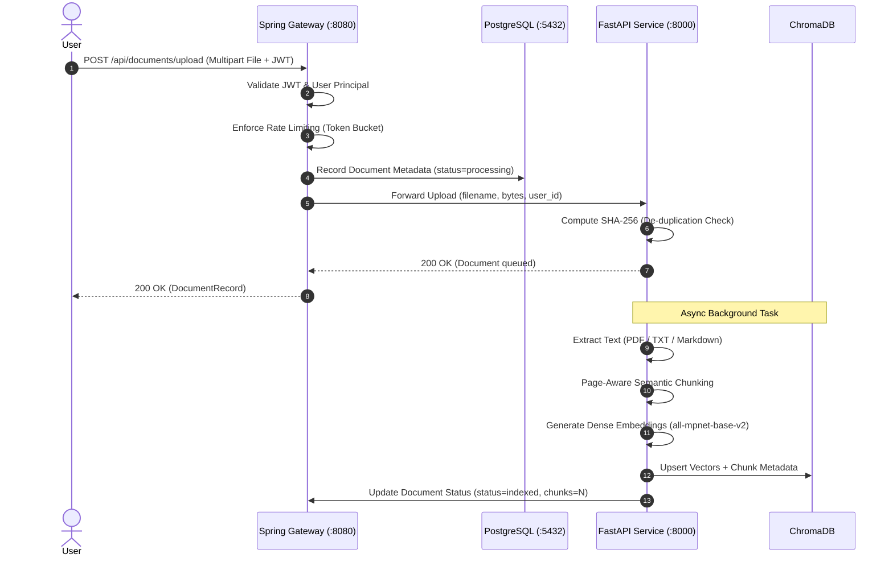
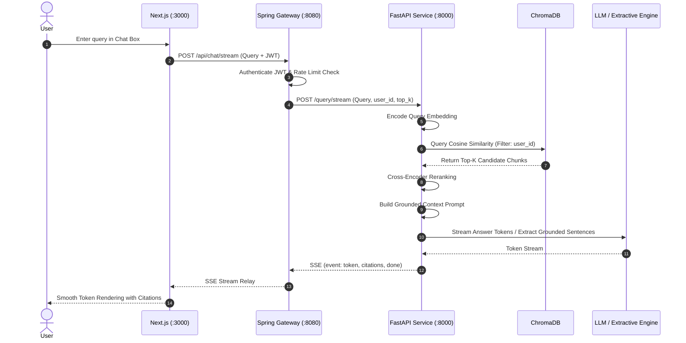

# 🏗️ System Architecture & Engineering Design

This document details the architecture, component interaction, and design patterns of the **Full-Stack Retrieval-Augmented Generation (RAG) Pipeline**.

---

## 📐 Architecture Diagrams

### 1. Detailed Monochrome System Architecture

- **High-Resolution Image**: [`docs/images/system_architecture.png`](./images/system_architecture.png)
- **Editable Vector Source**: [`docs/images/architecture.svg`](./images/architecture.svg)

### 2. Multi-Tier Component Flow

- **Component Tier Image**: [`docs/images/architecture_flow.png`](./images/architecture_flow.png)

---

## 🧩 Architectural Topology

---

## 🔄 End-to-End Request Lifecycles

### 1. Document Ingestion Lifecycle

### 2. Grounded Query & SSE Streaming Lifecycle

---

## 🛡️ Security, Reliability & Scaling Patterns

1. **Defense-in-Depth Authentication**:
   - Spring Security Resource Server with stateless JWT Bearer token verification.
   - Demo user seeder with BCrypt password hashing.
   - User isolation enforced in metadata database and propagated to vector retrieval filters (`user_id`).

2. **Traffic Governance**:
   - Token bucket rate limiting filter on API gateway preventing denial-of-service and abusive querying.
   - Configurable capacity, refill tokens, and refill time windows via environment variables.

3. **Fault Tolerance**:
   - Dual-mode generation: Local Ollama LLM support with automatic fallback to high-precision extractive grounding.
   - Asynchronous worker queues preventing large document indexing from blocking API gateway threads.
